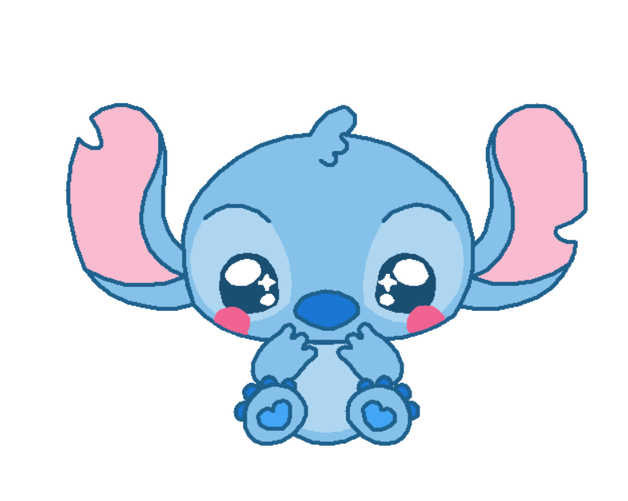

<p align="center">
  
  
</p>

<h1 align="center">🐢 Turtle Art Beats</h1>

## 📖 About the Project

Welcome to **Turtle Art Beats**! This is a fun and creative Python project that uses the built-in `turtle` library to draw beautiful, animated graphics while playing background music using `pygame`.

Currently, the project features two main graphical scripts:

1. **A Beating Heart:** An intricate mathematical drawing of a heart made of multiple overlapping hearts, complete with a custom signature.
2. **Stitch:** A detailed, step-by-step coloring and drawing of the beloved character Stitch from Disney's _Lilo & Stitch_.

## 🎨 Visual Previews

Here is what the scripts draw in real-time!

<p align="center">
  
  
</p>

## 🛠️ Installation & Setup

To run these scripts on your local machine, follow these steps:

### 1. Clone the Repository

```bash
git clone https://github.com/YOUR_USERNAME/Turtle-Art-Beats.git
cd Turtle-Art-Beats
```

### 2. Install Dependencies

The `turtle` and `math` libraries are built directly into Python, so you don't need to install them. However, we use `pygame` to handle the background music. You can install it easily using the provided `requirements.txt` file:

```bash
pip install -r requirements.txt
```

### 3. Run the Scripts

Simply execute either of the Python files to watch the magic happen!

```bash
python Corazon.py
# or
python Stitch.py
```

## 🎵 How to Customize the Music

One of the best features of this project is that you can easily swap out the background music for any song you like!

1. Place your desired audio file (preferably `.mp3` or `.wav`) inside the **`Music/`** folder (Note: Ensure the 'M' is capitalized).
2. Open either `Corazon.py` or `Stitch.py` in your text editor.
3. Locate the `pygame.mixer.music.load()` line near the top of the file.
4. Change the file path to match your new song. For example:

```python
# Change this:
pygame.mixer.music.load("Music/He Mele No Lilo.mp3")

# To this:
pygame.mixer.music.load("Music/your_new_song.mp3")
```

5. Save and run the script again to enjoy your custom soundtrack!

## 👨‍💻 Author & Contact

Developed by **Daniel Willson Pastor**.

<p align="center">
  <a href="https://github.com/dwp28">
    
  </a>
  <a href="https://www.linkedin.com/in/danielwillsonpastor/">
    
  </a>
</p>
